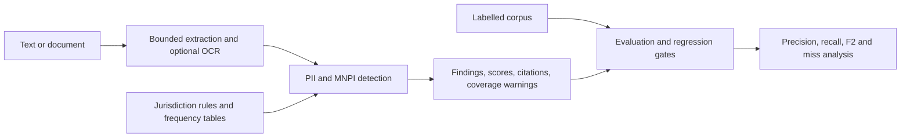

# Classifier architecture

Junas is a local analysis library and research CLI. There is no HTTP service or product adapter in the current tree.

`src/junas/models.py` holds transport-independent inputs and classification labels. `src/junas/pipeline.py` combines document extraction, explicitly configured OCR and `PreSendReviewEngine`. `src/junas/review/engine.py` retains the existing detection and scoring logic. Structured document locations and OCR coordinates remain attached to evidence.

The `strict` profile never constructs retrieval or LLM adjudicators. `audit_grade` is an explicit experiment, using configuration and provider privacy gates. Deterministic high-severity evidence cannot be cleared by optional helpers. Research results distinguish those configurations rather than pooling their accuracy.

Cross-document defined terms are explicit input (`context_terms`). There is no implicit session/matter storage, approval state, journal, mapping store, tenant authentication, send policy, or telemetry service. Citation override selectors and provider opt-in fields remain part of the experimental analysis configuration; they are not an identity system.

The engine's rule-based risk scores are not calibrated probabilities. A completed analysis is not proof of complete detection. Degraded parsing/OCR must remain visible, and evaluation must not quietly treat failed extraction as clean text.

The default package contains the local pipeline. NER, OCR and cloud OCR dependencies are optional extras. Evaluation uses direct engine calls so infrastructure and adapters cannot alter detector measurements.
