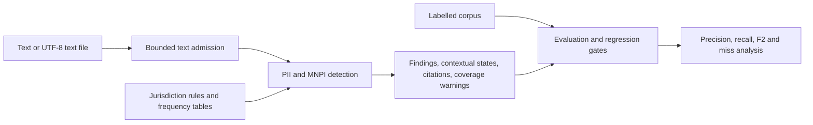

# Classifier architecture

Junas is a text-only analysis library and research CLI. There is no HTTP service, native document parser, OCR or product adapter in the current tree.

`DocumentInput(text=...)` is the public input model. `ReviewPipeline` accepts inline text or bounded UTF-8 text files and passes their exact characters to `PreSendReviewEngine`. Evidence offsets refer to that text. PDF, Office, email/MIME, archives, images, OCR and base64-document inputs have been removed. Retired input/configuration paths fail explicitly. Historical fixtures/reports remain for provenance; they do not describe active format support.

The `strict` profile never constructs retrieval or LLM adjudicators. `audit_grade` is an explicit experiment, using configuration and provider privacy gates. Deterministic high-severity evidence cannot be cleared by optional helpers. Research results distinguish those configurations rather than pooling their accuracy.

Cross-document defined terms are explicit input (`context_terms`). There is no implicit session/matter storage, approval state, journal, mapping store, tenant authentication, send policy, or telemetry service. Citation override selectors and provider opt-in fields remain part of the experimental analysis configuration; they are not an identity system.

The review contract is `junas.review.v2`. Contextual decisions live in `sensitivity.pii.state` and `sensitivity.mnpi.state`, with `present`, `not_detected` or `unknown` states and source evidence. Document risk scores, finding scores, the `Classification` enum and the `SAFE`/`LOW_RISK`/`HIGH_RISK` document decision were removed. A completed analysis is not proof of complete detection; `not_detected` does not establish absence. Optional local NER degradation remains visible. See the [migration](docs/review-v2-migration.md).

NER is an optional text-only extra. Parser, image and cloud OCR dependencies were removed. Evaluation uses direct engine calls so transport adapters cannot alter detector measurements.

`scripts/model_corpus.py` is a separate, opt-in automated research workflow: generate new synthetic text, annotate it with different models, validate exact source spans, retain disagreements and compare the strict classifier with model-consensus labels. It does not modify the classifier, human-review packet or historical locks. See [the automated-corpus contract](docs/automated-corpus.md).
